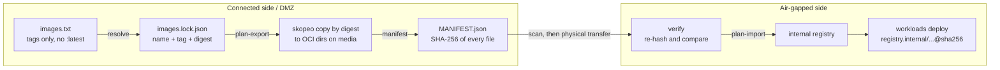

# airgap-image-sync

[](https://github.com/mest0006/airgap-image-sync/actions/workflows/ci.yml)

A small CLI for moving container images into an air-gapped Kubernetes environment safely: resolve every image to a digest, copy by digest onto transfer media, hash everything, verify on the inside, and load into the internal registry so workloads deploy by digest.

I built it around a problem I hit running offline clusters: images referenced by mutable tags (especially `:latest`) drift between the connected side and the enclave, and pulls fail or, worse, run something nobody scanned. Pinning to digests at the start of the transfer fixes both.

## How it works



| Command | Side | What it does |
|---|---|---|
| `resolve images.txt` | connected | Rejects `:latest` and untagged refs, resolves tags to digests with `skopeo inspect`, writes a sorted lockfile. |
| `plan-export lock --media DIR` | connected | Prints `skopeo copy --all --preserve-digests` commands from `repo@digest` to OCI directories. |
| `manifest DIR` | connected | Writes `MANIFEST.json` with the SHA-256 of every file on the media. |
| `verify DIR` | air-gapped | Re-hashes the media; reports missing, unexpected and changed files and exits non-zero. |
| `plan-import lock --media DIR --registry HOST` | air-gapped | Prints commands that load each archive into the internal registry (digests preserved) and the by-digest references to deploy. |

Commands print plans instead of running them, so they can be reviewed and logged as part of a formal transfer procedure, then piped to `bash` when approved.

## Example

```bash
python -m airgap_sync resolve examples/images.txt -o images.lock.json
python -m airgap_sync plan-export images.lock.json --media /mnt/transfer | bash -e
python -m airgap_sync manifest /mnt/transfer
# ... scan and carry the media across ...
python -m airgap_sync verify /mnt/transfer
python -m airgap_sync plan-import images.lock.json --media /mnt/transfer --registry registry.internal:5000 | bash -e
```

## Testing

- 15+ unit tests (`python -m unittest discover -s tests`), standard library only.
- CI runs a real end to end transfer: resolve two public images, export them with skopeo, hash and verify the media, prove that tampering with a layer is detected, load into a local registry, and check that the digest inside matches the lockfile.

## Requirements

Python 3.10+ and [skopeo](https://github.com/containers/skopeo). No Docker daemon needed.

## License

MIT
